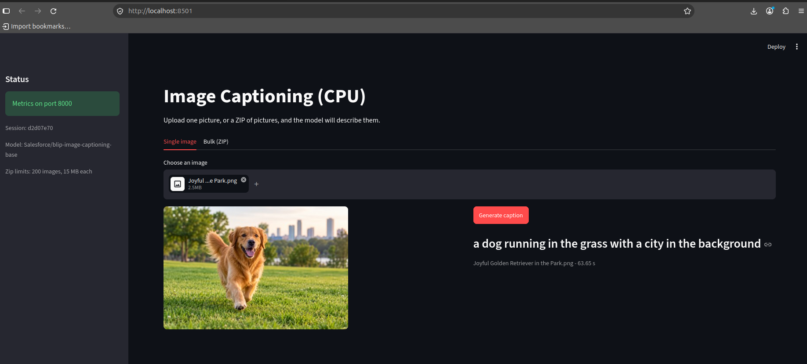
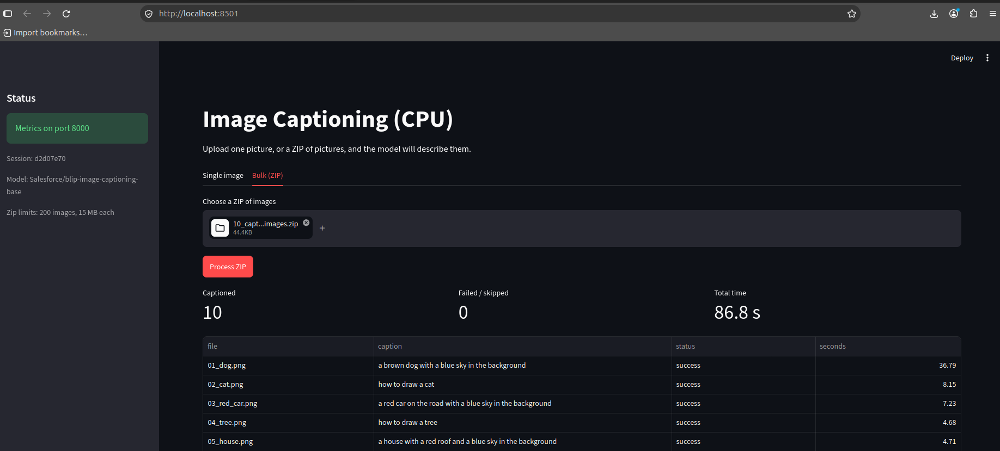
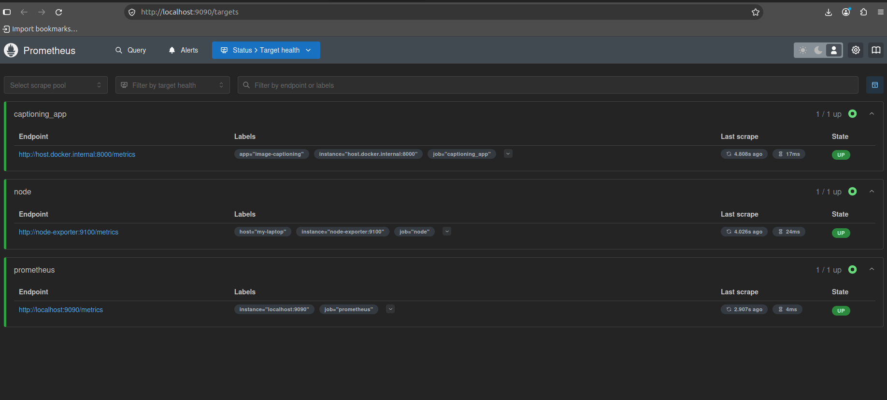
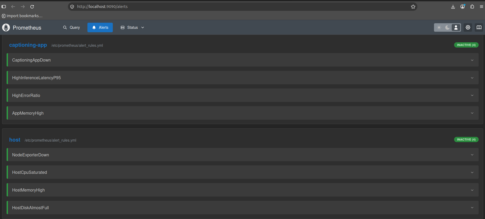
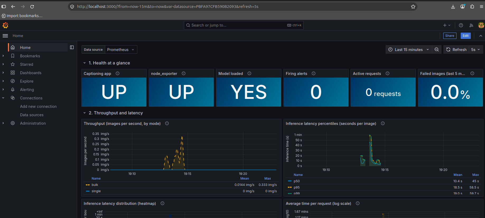
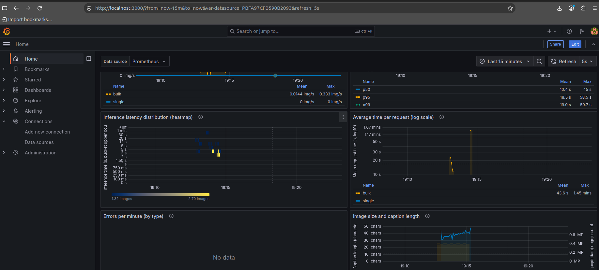
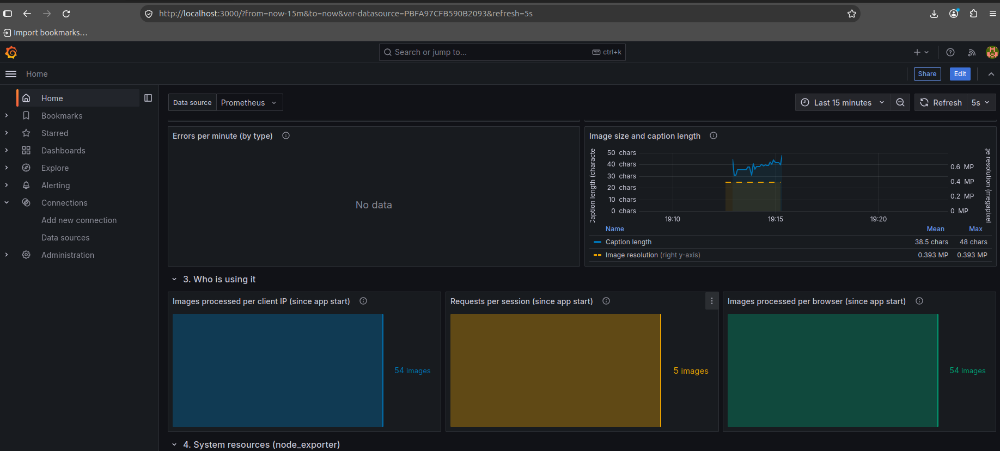
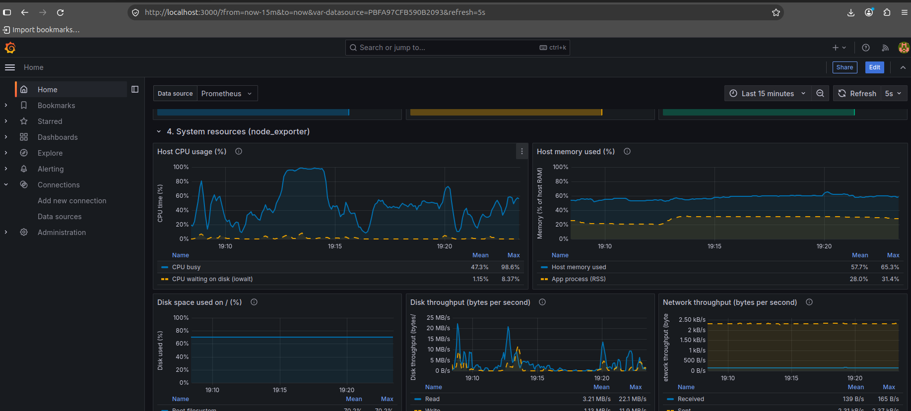
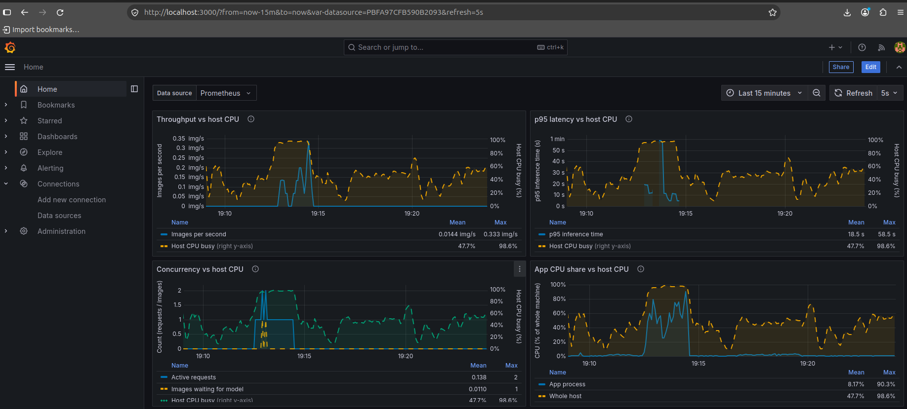

# DA3408 A4: Application Monitoring with Prometheus and Grafana

This project is a Streamlit app that captions images on CPU with BLIP-base. The app is instrumented with
`prometheus_client`, and Prometheus, node_exporter, Alertmanager and Grafana watch it. Most of the work went into
choosing metrics that explain what the machine is doing while the app is busy, so that a spike in the app can be
matched with a spike in CPU, memory or disk.

---

## 1. Where to find each item the assignment asks for

Each row is something the assignment PDF asks for, and where it is in this repo.

### Final deliverables

| What the assignment asks for | Where it is |
|------------------------------|-------------|
| GitHub repo with the Streamlit app | `app/` (UI in `app/app.py`) and the launcher `run.py` |
| `prometheus.yml` | `prometheus/prometheus.yml` |
| JSON export of the Grafana dashboard | `dashboard_export/captioning-observability-grafana-export.json` (downloaded from the Grafana UI, Export > JSON) |
| Guide on how to understand, set up and run the code | This README: section 2 (repo structure) and section 3 (how to run) |
| PromQL / regex written by AI must be commented with the prompt | Header of `prometheus/alert_rules.yml`, `docs/PROMQL_NOTES.md`, and `AI_DISCLOSURE.md` |

About the two dashboard files: `dashboard_export/...export.json` is the file I downloaded from Grafana. The file in
`grafana/dashboards/` has the same 29 panels and the same queries. It is only there so that `docker compose up`
loads the dashboard automatically. If you want to import by hand: Grafana > Dashboards > New > Import, upload the
export file, and pick your Prometheus data source.


| Category |What to look at |
|----------|-----------------|
| Python instrumentation | `app/metrics.py` has every counter, gauge, histogram and summary with labels (section 4 lists them). `app/processing.py` is where the values are recorded. `app/app.py` collects client IP, browser and session ID for the labels. Live output is at `localhost:8000/metrics`, and a saved copy is in `docs/sample_metrics.txt`. |
| Node exporting |`node-exporter` service in `docker-compose.yml`, the `node` job in `prometheus/prometheus.yml`, and screenshot `03-prometheus-targets-all-up.png`. |
| Grafana intuitiveness |Dashboard JSON, section 5 of this README (the seven commandments), screenshots 05 to 11. The layout goes from health, to throughput and latency, to clients, to host resources, to correlation. |
| Application logic |`app/app.py` and `app/processing.py` handle single images and ZIP files. Bad files, non-image entries, oversized files and invalid ZIPs are skipped or reported, not crashed on. Screenshots 01 and 02. |

---

## 2. Repo structure

```
DA3408_Assignment4/
├── README.md                      this file
├── AI_DISCLOSURE.md               how AI was used in this assignment
├── run.py                         launcher: opens the metrics port, then starts Streamlit
├── requirements.txt
├── docker-compose.yml             Prometheus, Alertmanager, node_exporter, Grafana
├── app/
│   ├── app.py                     Streamlit UI (Single image tab, Bulk ZIP tab)
│   ├── processing.py              image and ZIP handling, records the metrics
│   ├── metrics.py                 every metric definition + the /metrics server
│   └── captioner.py               loads BLIP-base on CPU
├── prometheus/
│   ├── prometheus.yml             scrape config: app, node_exporter, Prometheus itself
│   └── alert_rules.yml            8 alert rules
├── alertmanager/
│   └── alertmanager.yml           groups the alerts
├── grafana/
│   ├── dashboards/                dashboard that docker compose loads automatically
│   └── provisioning/              data source + dashboard provider config
├── dashboard_export/              the dashboard JSON export (deliverable)
├── docs/
│   ├── PromQL_notes.md            every query explained
│   └── sample_metrics.txt         copy of /metrics taken after a run
├── scripts/
│   └── make_zip.py                builds a test ZIP for the Bulk tab
└── screenshots/                   numbered in the order of the demo
```

What the main files do:

- `run.py` starts the metrics server on port 8000 first and then starts Streamlit on 8501. Streamlit only runs
  the script when someone opens the page, so without this launcher Prometheus would show the app as down until a
  browser connects.
- `app/app.py` is the interface. It also works out the client IP, the browser (from the User-Agent) and a short
  session ID, which become metric labels.
- `app/processing.py` opens each image, runs the model, and records the timing, counts and errors. For ZIP files it
  skips hidden files, non-images and oversized entries, reads at most 15 MB per entry and 200 images per ZIP.
- `app/metrics.py` holds all the metric definitions in one place, and creates the label combinations at startup so
  `rate()` does not miss the first increment.
- `docker-compose.yml` runs the monitoring stack. The app itself runs on the host, not in Docker.

---

## 3. How to run

Tested on Ubuntu Linux with Docker Compose v2 and Python 3.14. Python 3.10 or newer should also work.
Allow about 1.5 GB of disk space for torch and the model.

```bash
# 1. Python environment
python3 -m venv .venv
source .venv/bin/activate
pip install torch --index-url https://download.pytorch.org/whl/cpu
pip install -r requirements.txt

# 2. Monitoring stack (Prometheus, Alertmanager, node_exporter, Grafana)
docker compose up -d
docker compose ps                  # all four should say running

# 3. The app (first run downloads the BLIP model, about 1 GB)
python run.py
```

| What | URL | Login |
|------|-----|-------|
| App | http://localhost:8501 | |
| Raw app metrics | http://localhost:8000/metrics | |
| Prometheus targets | http://localhost:9090/targets | |
| Prometheus alerts | http://localhost:9090/alerts | |
| Alertmanager | http://localhost:9093 | |
| Grafana dashboard | http://localhost:3000 | admin / admin |

The three targets (`captioning_app`, `node`, `prometheus`) should all be UP. The dashboard opens as the Grafana home
page and refreshes every 5 seconds.

To create load for the Bulk tab:

```bash
python scripts/make_zip.py --src ~/Pictures --n 40 --out bulk_40.zip
# or, without any photos:
python scripts/make_zip.py --synthetic --n 30 --out bulk_30.zip
```

upload a few single images and then a ZIP and watch section 5 of the dashboard. Upload something
that is not a ZIP to see the error counters move. Stop the app with Ctrl+C: the status tile goes DOWN within 5 s and
`CaptioningAppDown` goes pending, then firing after 30 s.

To stop everything: Ctrl+C for the app, then `docker compose down`.

---

## 4. Metrics

| Type | Metric | Labels | What it is for |
|------|--------|--------|----------------|
| Counter | `captioning_requests_total` | mode, client_ip, session_id | uploads per client and session |
| Counter | `captioning_images_processed_total` | mode, status | throughput and error ratio |
| Counter | `captioning_client_images_total` | mode, client_ip, browser | who creates the load |
| Counter | `captioning_errors_total` | mode, error_type | what is failing |
| Counter | `captioning_upload_bytes_total` | mode | data volume |
| Counter | `captioning_zip_entries_skipped_total` | reason | junk inside ZIP files |
| Gauge | `captioning_active_requests` | mode | requests in progress |
| Gauge | `captioning_inference_queue_waiting` | none | images waiting for the model |
| Gauge | `captioning_model_loaded`, `_model_load_seconds`, `_model_param_bytes` | none | model state and size in memory |
| Gauge | `captioning_process_resident_memory_bytes`, `_process_cpu_percent` | none | footprint of the app process, read at scrape time |
| Gauge | `captioning_last_batch_size`, `_bulk_progress_ratio` | none | state of the current bulk job |
| Histogram | `captioning_inference_seconds` | mode | time per image, used for p50/p95/p99 |
| Histogram | `captioning_request_seconds` | mode | time per whole request |
| Histogram | `captioning_upload_size_bytes`, `_bulk_batch_size`, `_lock_wait_seconds` | mode or none | sizes and waiting time |
| Summary | `captioning_request_duration_seconds` | mode | `_sum` and `_count`, average request time |
| Summary | `captioning_caption_chars`, `_image_megapixels` | mode | caption length and input resolution |
| Info | `captioning_app_info` | model, device, version | what is deployed |

Notes:

- The Python client's Summary only exposes `_sum` and `_count`, with no quantiles, so percentiles come from the
  histogram. Averages on the dashboard are `rate(_sum) / rate(_count)`. Counters give the `_total` suffix.
- `client_ip` and `session_id` can have many values in theory. That is fine here, but in a real deployment I would
  drop `session_id` or group it into a few buckets.
- Inference runs behind a lock because there is one model on a small CPU. So "active requests" can be higher than
  the number of images actually running, and the queue gauge shows the difference.

---

## 5. Dashboard and the seven commandments

Sections, from high level to low level: **1** health at a glance, **2** throughput and latency, **3** who is using
it, **4** system resources (node_exporter), **5** application vs system correlation.

| Commandment | How the dashboard handles it |
|-------------|------------------------------|
| Colour palette for colour-blind viewers | Okabe-Ito colours only. The heatmap uses Cividis. Status tiles also print UP/DOWN or YES/NO, so colour is never the only signal. |
| Markers work across media | Series in the same panel also differ by line style (solid, dashed, dotted), so they can be told apart in print or grayscale. |
| Axes named | Every y-axis has a label for the quantity. Time is the shared x-axis. |
| Scale and units explicit | Units are set on every axis (s, %, bytes/s, img/s). The one log axis ("Average time per request") says log10 in its label. |
| Legend when more than one variable | Legend table with mean and max on every multi-series panel. |
| Brief title and subtitle | Short title, and the first sentence of the panel description (the "i" icon) is the subtitle. |
| Story of the plot | The rest of each description says what to look for. |

Queries were checked against a live Prometheus with node_exporter running while a load script ran. Every query
returned data. The logic of each query is written down in `docs/PromQL_notes.md`.

---

## 6. Alerts

`prometheus/alert_rules.yml` has 8 rules: app down, node_exporter down, p95 inference latency above 10 s, error
ratio above 10%, app memory above 3 GB, host CPU above 90%, host memory above 90%, and root disk above 85%.
Prometheus sends them to Alertmanager, which groups them. No outside receiver (email, Slack) is set up. The file
has a comment showing where one would go.

---

## 7. Screenshots

All taken on my machine while the app and the stack were running.

**App**



Single mode: the model returned a caption for a photo of a dog. The first caption took 63.65 s because the model
was running for the first time.



Bulk mode: a ZIP with 10 images, all captioned, total time 86.8 s. The first image was the slowest (36.79 s) and
the rest took about 5 to 8 s each.

**Prometheus**



All three scrape targets are UP: the app, node_exporter and Prometheus itself.



Both rule groups loaded (4 rules each). Nothing is firing, which is expected when the system is healthy.
`04b-prometheus-alerts-cropped.png` is an earlier, cropped capture of the same page.

**Grafana**



Section 1 and the start of section 2. The app and node_exporter are UP, the model is loaded, no alerts are firing.
Bulk throughput and the latency percentiles show the bulk run.



Latency distribution as a heatmap, and the average request time on a log axis.



Caption length vs image resolution, and the client breakdown. The errors panel says "No data" because no errors
happened in this window.



Section 4: host CPU, memory (host vs the app process), disk usage, disk throughput and network.



Section 5: throughput, p95 latency, concurrency and the app's own CPU share, each plotted against host CPU.
`09-...` and `10-...` are the same area captured while scrolling.

---

## 8. What the data showed

From the run in the screenshots above:

- During the bulk job, host CPU went up to 98.6% (mean over the 15 minutes was about 48%), and the app process
  alone used up to 90.3% of the whole machine.
- p95 inference time reached 58.5 s and p99 59.7 s at the peak. In the same window, throughput peaked at 0.333
  images/s, active requests reached 2 and one image was waiting for the model.
- When CPU saturated, the tail latency grew and images queued up. This is what a CPU-bound workload looks like, and
  the correlation panels in section 5 show it directly.
- Host memory stayed around 58% (peak 65%). The app process held roughly 28 to 31% of host RAM. It stepped up
  once, when the model was first used, and then stayed flat while the load changed, so most of it is the model
  weights and not per-request memory.
- The first request after loading the model is much slower than later ones (63.65 s for the first single image,
  36.79 s for the first image in the ZIP), so the first inference should be treated as a warm-up.

---

## 9. AI usage

I used Claude while working on this assignment. The details are in
[`AI_DISCLOSURE.md`](AI_DISCLOSURE.md): which parts AI helped with, what the prompts were, and where the AI-generated
PromQL and regex are commented.

---


